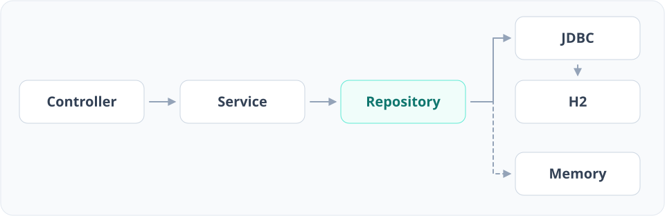
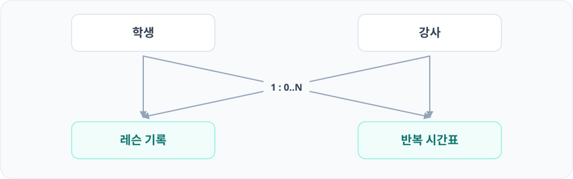

<!-- 프로젝트 개요·구현 흐름·실행 안내 -->
# Minuet

**학생·강사·레슨을 관리하며, 저장소 인터페이스로 메모리와 JDBC 구현을 분리한 Spring MVC 프로젝트**


**개인 프로젝트 · 개선 중** · 조동휘: 설계·구현

- Java 17·Gradle 8.13·로컬 H2에서 **전체 테스트 206개 통과**
- 수업 길이·구간 겹침·동시 등록·수정 확인, 운영 환경 검증 제외
- [등록 규칙](docs/LESSON_REGISTRATION.md) · [검증 조건과 한계](docs/VALIDATION.md)

[설계 포인트](#설계-포인트) · [프로젝트 구조](#project-structure) · [화면 경로](docs/ROUTES.md) · [실행 방법](docs/SETUP.md) · [검증 기록](docs/VALIDATION.md)

<picture>
  <source media="(max-width: 1000px)" srcset="docs/assets/repository-flow-mobile.svg">
  
</picture>

## 프로젝트 개요

- 음악 학원·개인 교습소의 학생·강사, 레슨 기록·반복 시간표 관리
- Spring MVC 요청 처리와 컨트롤러·서비스·저장소 계층 분리
- 저장소 인터페이스로 메모리·JDBC 구현 교체 가능하도록 구성

| 영역 | 다루는 정보 |
| :--- | :--- |
| 학생·강사 | 이름, 수강 횟수, 담당 과목 |
| 레슨 기록 | 학생·강사, 수업 일시, 완료 여부 |
| 레슨 시간표 | 학생·강사, 요일, 시작 시각·수업 길이 |

- 웹 화면: **등록·목록 조회** 구현, 수정·삭제는 서비스·저장소 계층에 구현
- 시간표: 수업 길이 입력·종료 시각 표시, 같은 요일의 강사 또는 학생 시간 겹침 거부
- 앞 수업 종료 시각에 시작 허용, DB 행 잠금으로 겹침 검사·저장을 한 트랜잭션으로 처리
- [입력·응답·동시성 설계](docs/LESSON_REGISTRATION.md)

## 설계 포인트

- 저장소 인터페이스로 메모리·JDBC 구현 분리
- 날짜별 레슨 기록·요일별 반복 시간표 분리
- 계층별 정상 동작·오류 시나리오 테스트 작성

<details>
<summary>설계·구현 코드 보기</summary>

### 01. 저장 방식과 서비스 책임 분리

- 서비스는 저장소 인터페이스에 의존, 메모리·JDBC 구현 분리
- `AppConfig`에서 사용할 구현 연결, 기본 구성은 **JDBC**

- 설정 코드로 저장 방식 교체, 런타임 자동 전환 미지원

[의존성 구성](src/main/java/com/zandhidokkie/minuet/config/AppConfig.java) · [저장소 인터페이스](src/main/java/com/zandhidokkie/minuet/repository) · [JDBC 구현](src/main/java/com/zandhidokkie/minuet/repository/jdbc)

### 02. 레슨 기록과 반복 시간표 구분

- 특정 날짜의 기록 `LessonInfo`와 요일·시간 기준 반복 시간표 `LessonSlot` 분리
- 두 모델에서 학생·강사 참조

<picture>
  <source media="(max-width: 1000px)" srcset="docs/assets/lesson-relations-mobile.svg">
  
</picture>

[도메인 모델](src/main/java/com/zandhidokkie/minuet/domain) · [DB 스키마](src/main/resources/schema.sql)

### 03. 계층별 동작과 오류 시나리오 테스트

- 학생·강사·레슨의 정상 처리와 없는 데이터 조회·수정·삭제 테스트 작성

| 검증 코드 | 확인하려는 동작 |
| :--- | :--- |
| [서비스](src/test/java/com/zandhidokkie/minuet/service/StudentServiceTest.java) | 학생 등록·조회·수정·삭제 |
| [저장소](src/test/java/com/zandhidokkie/minuet/repository) | 메모리·JDBC 데이터 접근 |
| [웹](src/test/java/com/zandhidokkie/minuet/controller) | 요청과 화면 처리 |
| [오류](src/test/java/com/zandhidokkie/minuet/integration/ErrorScenarioTest.java) | 존재하지 않는 데이터 처리 |

- 실행 결과·남은 확인 범위: [검증 기록](docs/VALIDATION.md)

</details>

<a id="project-structure"></a>

## 📂 프로젝트 구조

주요 코드·문서 기준.

```text
Minuet_project/
├── src/main/java/com/zandhidokkie/minuet/  # 애플리케이션 코드
│   ├── config/  # 저장소 구현체 연결
│   ├── controller/  # 등록·목록 화면 요청
│   ├── service/  # 학생·강사·레슨 처리
│   ├── domain/  # 레슨 기록·반복 시간표 모델
│   └── repository/  # 저장소 인터페이스·구현체
│       ├── jdbc/  # JDBC 구현
│       └── memory/  # 메모리 구현
├── src/main/resources/  # 설정·화면·DB 초기화
│   ├── templates/  # Thymeleaf 화면
│   └── schema.sql  # 테이블 정의
├── src/test/  # 계층별·오류 시나리오 테스트
└── docs/  # 실행·화면 경로·검증 문서
```

## 실행과 코드 탐색

- [실행 방법](docs/SETUP.md): JDK 17, Gradle Wrapper, H2 초기화와 데이터 유지 범위
- [화면 경로](docs/ROUTES.md): 실제 컨트롤러의 대소문자를 반영한 URL
- [서비스 계층](src/main/java/com/zandhidokkie/minuet/service): 비즈니스 처리
- [화면 템플릿](src/main/resources/templates): Thymeleaf 기반 화면

## 현재 한계와 다음 개선

- 수정·삭제 화면 연결 필요, 자정 초과 수업 미지원, H2 종료 시 데이터 소멸
- H2 초기화 수정·HTTP 등록·조회 결과와 남은 범위: [검증 기록](docs/VALIDATION.md)
- 시간표의 24:00 종료 등 세부 규칙: [등록 규칙](docs/LESSON_REGISTRATION.md)

<details>
<summary>학습 배경</summary>

- Spring Boot 구조·MVC 요청 처리·계층형 설계 학습
- JDBC 데이터 접근·테스트 작성 연습

</details>

